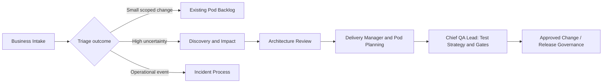

# Concept-only diagram — replace with verified app facts
This is an **illustrative workflow**, NOT a representation of Stratifi, Equity Markets or Prime Services integrations.

Unknown: actual organizational authority, pod routing, tool integrations, exception procedures.
